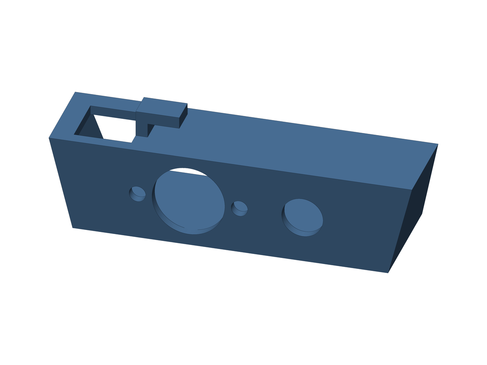
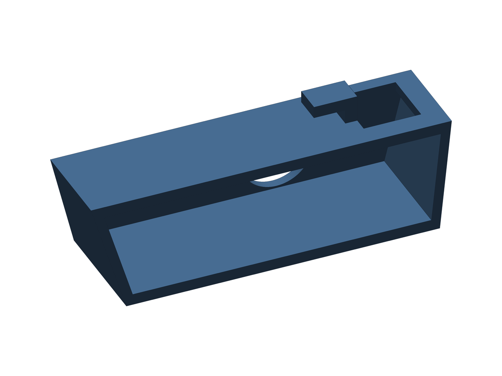

# Bracket with a 5-pin DIN jack and 1 RCA jack

Bracket for the Atari 2600 AV mod with **one 5-pin DIN jack and one RCA jack**. The DIN jack is the 5-pin, 180° type, the same kind used for the monitor port of the Atari 800.

 

Case: 76.2 mm long at the top and 66.2 mm at the base, 20.21 mm high, 24.89 mm deep at the bottom and 19.30 mm at the top (slanted back). Wall 2.0 mm, L hook 6 mm wide, top opening 12.10 × 12.10 mm. Same as the 3-hole version.

**Holes:** DIN body 15.3 mm (15 + 0.3 clearance) at x = 34.1 mm from the opening end, with two M3 holes (3.2 + 0.3 clearance) for the flange screws at x = 23.4 / 44.8 mm (21.4 mm apart). RCA 8.7 mm (8.4 + 0.3) at x = 58.0 mm. The DIN and the RCA are centered together on the face, with 13.1 mm free on each side.

**Flange:** the DIN jack is the type with an oval flange and two screws, not a threaded nut, because a nut does not fit in the 16.2 mm inner height of the case. The flange sits on the outside of the front face. It is estimated at 27 × 18 mm, which leaves about 1 mm above and below it, and about 2.8 mm to the nut of the RCA jack.

**Files:** `exports/av_bracket_din5_print.stl` (print this one, RCA face down, no supports), `exports/av_bracket_din5.stl` (Fusion orientation) and `exports/av_bracket_din5.step`. Optional Fusion scripts: `english/av_bracket_din5_en` and `portuguese/av_bracket_din5_pt`.

**Check first:** this version has not been printed. The sizes come from retailer listings and from the photo of a PUREVOLT A-1462-5 jack, not from a datasheet or a measured jack: the 15 mm cutout and the 21.4 mm screw spacing come from a Maplin listing, and the 27 × 18 mm flange is estimated from the photo. A flange taller than about 19 mm will not fit in the 20.21 mm face. Measure the flange of your jack before printing. If the DIN hole is too small, enlarge it with a rotary tool.

Back to the [main README](../README.md).

---

# Suporte com 1 conector DIN de 5 pinos e 1 RCA

Suporte para o AV mod do Atari 2600 com **um conector DIN de 5 pinos e um RCA**. O DIN é do tipo de 5 pinos a 180°, o mesmo tipo usado na saída de monitor do Atari 800.

 

Case: 76,2 mm de comprimento no topo e 66,2 mm na base, 20,21 mm de altura, 24,89 mm de profundidade embaixo e 19,30 mm em cima (traseira inclinada). Parede de 2,0 mm, gancho em L de 6 mm de largura e abertura de cima de 12,10 × 12,10 mm. Igual à versão de 3 furos.

**Furos:** corpo do DIN de 15,3 mm (15 + 0,3 de folga) em x = 34,1 mm a partir da ponta da abertura, com dois furos M3 (3,2 + 0,3 de folga) para os parafusos da flange em x = 23,4 / 44,8 mm (21,4 mm entre eles). RCA de 8,7 mm (8,4 + 0,3) em x = 58,0 mm. O DIN e o RCA ficam centralizados juntos na face, com 13,1 mm livres de cada lado.

**Flange:** o conector DIN é do tipo com flange oval e dois parafusos, e não com porca rosqueada, porque a porca não cabe nos 16,2 mm de altura interna da case. A flange fica por fora da face da frente. Ela é estimada em 27 × 18 mm, o que deixa cerca de 1 mm acima e abaixo, e cerca de 2,8 mm até a porca do RCA.

**Arquivos:** `exports/av_bracket_din5_print.stl` (imprima este, com a face RCA para baixo e sem suportes), `exports/av_bracket_din5.stl` (orientação do Fusion) e `exports/av_bracket_din5.step`. Scripts opcionais do Fusion: `english/av_bracket_din5_en` e `portuguese/av_bracket_din5_pt`.

**Confira antes:** esta versão não foi impressa. As medidas vêm de listagens de lojas e da foto de um conector PUREVOLT A-1462-5, não de um datasheet nem de um conector medido: o recorte de 15 mm e o espaçamento de 21,4 mm dos parafusos vêm de uma listagem da Maplin, e a flange de 27 × 18 mm é estimada pela foto. Uma flange com mais de uns 19 mm de altura não cabe na face de 20,21 mm. Meça a flange do seu conector antes de imprimir. Se o furo do DIN ficar pequeno, aumente-o com uma microrretífica.

Voltar ao [README principal](../README.md).
