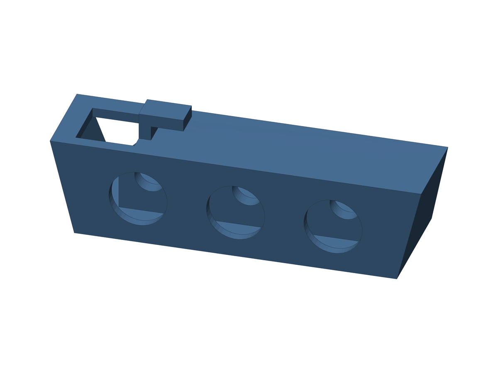
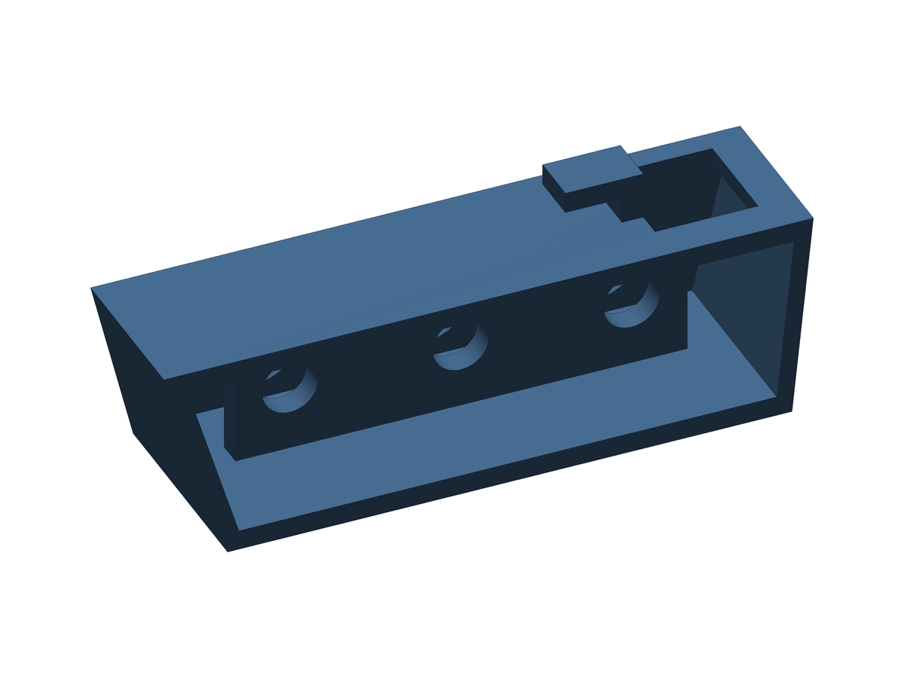

# Bracket with 3 recessed RCA jacks (inner mounting panel)

Same case as the 3-hole version, but the jacks are **screwed onto an inner panel** and sit **recessed** behind the front face, instead of being pressed into the front wall.

 

Case: 76.2 mm long at the top and 66.2 mm at the base, 20.21 mm high, 24.89 mm deep at the bottom and 19.30 mm at the top (slanted back). Wall 2.0 mm, L hook 6 mm wide, top opening 12.10 × 12.10 mm. Same as the 3-hole version.

**Front holes:** 3 × 12.0 mm, 20.0 mm apart, centers at x = 22.9 / 42.9 / 62.9 mm from the opening end (the middle one is at the center of the part).

**Inner panel:** 3.0 mm thick, 53.0 mm wide, starting 16.35 mm from the opening end, with its front face 9.0 mm behind the RCA face, so the jack bodies are recessed up to 9 mm. It has 3 × 6.57 mm holes at the same centers, for the jack barrels (fixed with their own nuts). Its corner next to the top opening has a 45° bevel of 7.58 mm, which keeps the cable path free.

**Files:** `exports/av_bracket_recessed_print.stl` (print this one, RCA face down), `exports/av_bracket_recessed.stl` (Fusion orientation) and `exports/av_bracket_recessed.step`. Optional Fusion scripts: `english/av_bracket_recessed_en` and `portuguese/av_bracket_recessed_pt`. The STEP is rebuilt from the parameters and matches the STL within 0.02% in volume. The Fusion scripts follow the same parameters but have only been syntax-checked, not run in Fusion. The STL is the reference.

**Check first:** the inner panel is a bridge of about 16 mm between the top and bottom walls when printed RCA face down. It was printed and validated by Jonatã Mariani, but the support and cooling settings he used are not recorded here. Also, the 12.0 mm and 6.57 mm holes come from the design of this version, not from a datasheet. Make sure your jack's body fits in 12.0 mm and its barrel in 6.57 mm.

**Credits:** this version was designed by Jonatã Mariani, from the YouTube channel [Veio dos Game](https://www.youtube.com/c/VeimdosGame), based on the original version of this project.

Back to the [main README](../README.md).

---

# Suporte com 3 conectores RCA embutidos (painel interno)

Mesma case da versão de 3 furos, mas os conectores são **parafusados num painel interno** e ficam **embutidos** atrás da face da frente, em vez de entrarem por pressão na parede.

 

Case: 76,2 mm de comprimento no topo e 66,2 mm na base, 20,21 mm de altura, 24,89 mm de profundidade embaixo e 19,30 mm em cima (traseira inclinada). Parede de 2,0 mm, gancho em L de 6 mm de largura e abertura de cima de 12,10 × 12,10 mm. Igual à versão de 3 furos.

**Furos da frente:** 3 × 12,0 mm, 20,0 mm entre centros, centros em x = 22,9 / 42,9 / 62,9 mm a partir da ponta da abertura (o do meio fica no centro da peça).

**Painel interno:** 3,0 mm de espessura e 53,0 mm de largura, começando a 16,35 mm da ponta da abertura, com a face da frente a 9,0 mm da face RCA, então o corpo dos conectores fica embutido até 9 mm. Tem 3 furos de 6,57 mm nos mesmos centros, para a rosca dos conectores (presos com a porca deles). O canto junto da abertura de cima tem um chanfro de 45° de 7,58 mm, que deixa o caminho do cabo livre.

**Arquivos:** `exports/av_bracket_recessed_print.stl` (imprima este, com a face RCA para baixo), `exports/av_bracket_recessed.stl` (orientação do Fusion) e `exports/av_bracket_recessed.step`. Scripts opcionais do Fusion: `english/av_bracket_recessed_en` e `portuguese/av_bracket_recessed_pt`. O STEP é reconstruído a partir dos parâmetros e bate com o STL em até 0,02% de volume. Os scripts do Fusion seguem os mesmos parâmetros, mas só passaram por checagem de sintaxe, sem rodar no Fusion. O STL é a referência.

**Confira antes:** o painel interno é uma ponte de cerca de 16 mm entre as paredes de cima e de baixo quando impresso com a face RCA para baixo. Ele foi impresso e validado pelo Jonatã Mariani, mas as configurações de suporte e de refrigeração que ele usou não estão registradas aqui. Além disso, os furos de 12,0 mm e 6,57 mm vêm do projeto desta versão, não de um datasheet. Confirme que o corpo do seu conector cabe em 12,0 mm e a rosca em 6,57 mm.

**Créditos:** esta versão foi criada por Jonatã Mariani, do canal do YouTube [Veio dos Game](https://www.youtube.com/c/VeimdosGame), com base na versão original deste projeto.

Voltar ao [README principal](../README.md).
