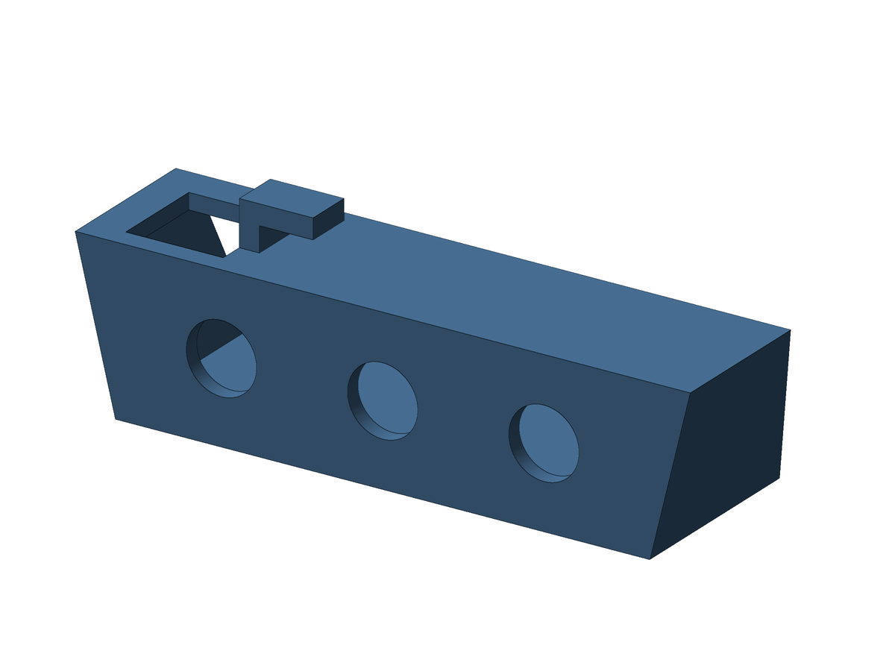
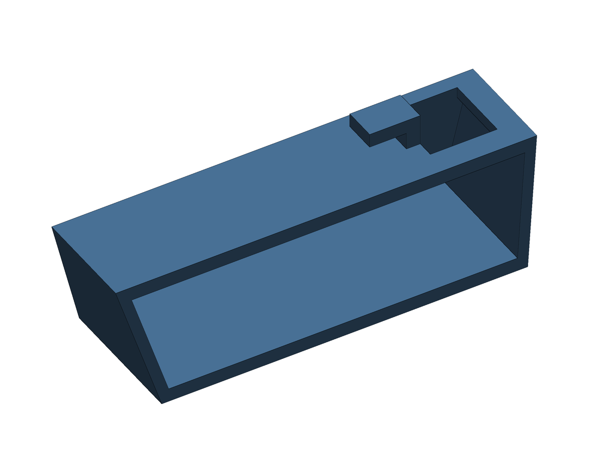

# Bracket with 3 RCA holes

Same case as the 4-hole version, with **3 RCA jacks** spread over the same width.

 

Case: 76.2 mm long at the top and 66.2 mm at the base, 20.21 mm high, 24.89 mm deep at the bottom and 19.30 mm at the top (slanted back). Wall 2.0 mm, L hook 6 mm wide, top opening 12.10 × 12.10 mm.

**Holes:** 3 × 8.7 mm (8.4 + 0.3 clearance), evenly spread: 4 equal gaps of 11.27 mm, centers at x = 22.93 / 42.90 / 62.87 mm from the opening end. The middle hole sits at the center of the part.

**Files:** `exports/av_bracket_3h_print.stl` (print this one, RCA face down, no supports), `exports/av_bracket_3h.stl` (Fusion orientation) and `exports/av_bracket_3h.step`. Optional Fusion scripts: `english/av_bracket_3h_en` and `portuguese/av_bracket_3h_pt`.

Back to the [main README](../README.md).

---

# Suporte com 3 furos RCA

Mesma case da versão de 4 furos, com **3 conectores RCA** distribuídos na mesma largura.

 

Case: 76,2 mm de comprimento no topo e 66,2 mm na base, 20,21 mm de altura, 24,89 mm de profundidade embaixo e 19,30 mm em cima (traseira inclinada). Parede de 2,0 mm, gancho em L de 6 mm de largura e abertura de cima de 12,10 × 12,10 mm.

**Furos:** 3 × 8,7 mm (8,4 + 0,3 de folga), distribuídos por igual: 4 vãos iguais de 11,27 mm, centros em x = 22,93 / 42,90 / 62,87 mm a partir da ponta da abertura. O furo do meio fica no centro da peça.

**Arquivos:** `exports/av_bracket_3h_print.stl` (imprima este, com a face RCA para baixo e sem suportes), `exports/av_bracket_3h.stl` (orientação do Fusion) e `exports/av_bracket_3h.step`. Scripts opcionais do Fusion: `english/av_bracket_3h_en` e `portuguese/av_bracket_3h_pt`.

Voltar ao [README principal](../README.md).
