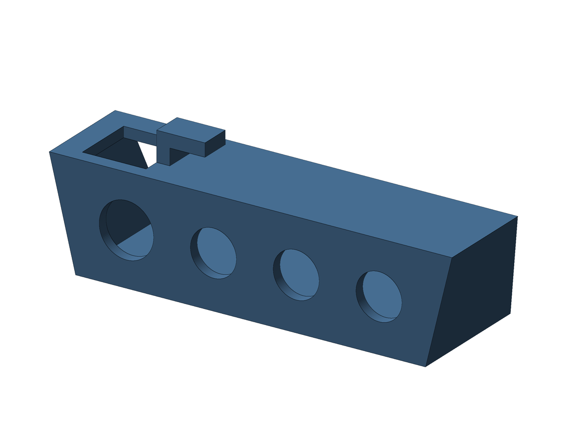
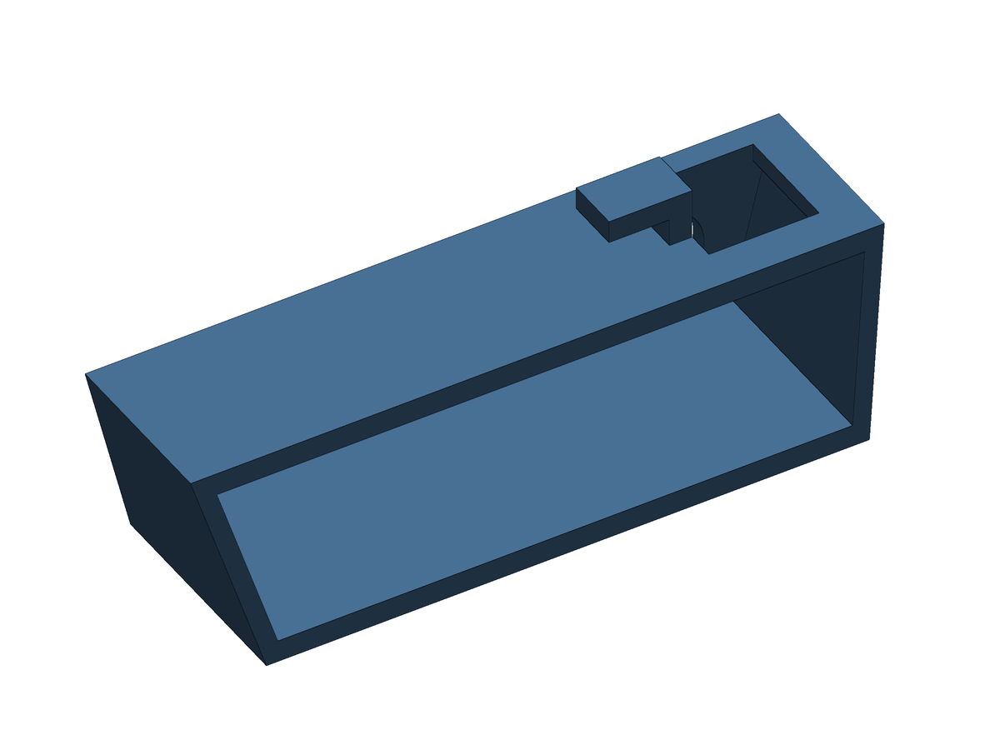

# Bracket with 3 RCA holes and 1 S-Video hole

Same case, with **3 RCA jacks and 1 S-Video jack**, the S-Video at the opening end (the left end facing the RCA face).

 

Case: 76.2 mm long at the top and 66.2 mm at the base, 20.21 mm high, 24.89 mm deep at the bottom and 19.30 mm at the top (slanted back). Wall 2.0 mm, L hook 6 mm wide, top opening 12.10 × 12.10 mm.

**Holes:** S-Video 10.3 mm (10 + 0.3 clearance) and 3 RCA of 8.7 mm, evenly spread: 5 equal gaps of 6.96 mm, centers at x = 19.41 (S-Video) / 35.87 / 51.53 / 67.19 mm from the opening end.

**Files:** `exports/av_bracket_svideo_print.stl` (print this one, RCA face down, no supports), `exports/av_bracket_svideo.stl` (Fusion orientation) and `exports/av_bracket_svideo.step`. Optional Fusion scripts: `english/av_bracket_svideo_en` and `portuguese/av_bracket_svideo_pt`.

**Check first:** the 10 mm size comes from retailer listings of round, threaded 4-pin mini-DIN panel sockets, not from a datasheet or a measured jack. A flanged S-Video jack with two screws needs extra holes that this version does not have. Measure your jack before printing.

Back to the [main README](../README.md).

---

# Suporte com 3 furos RCA e 1 furo S-Video

Mesma case, com **3 conectores RCA e 1 S-Video**, com o S-Video na ponta da abertura (a ponta esquerda, de frente para a face RCA).

 

Case: 76,2 mm de comprimento no topo e 66,2 mm na base, 20,21 mm de altura, 24,89 mm de profundidade embaixo e 19,30 mm em cima (traseira inclinada). Parede de 2,0 mm, gancho em L de 6 mm de largura e abertura de cima de 12,10 × 12,10 mm.

**Furos:** S-Video de 10,3 mm (10 + 0,3 de folga) e 3 RCA de 8,7 mm, distribuídos por igual: 5 vãos iguais de 6,96 mm, centros em x = 19,41 (S-Video) / 35,87 / 51,53 / 67,19 mm a partir da ponta da abertura.

**Arquivos:** `exports/av_bracket_svideo_print.stl` (imprima este, com a face RCA para baixo e sem suportes), `exports/av_bracket_svideo.stl` (orientação do Fusion) e `exports/av_bracket_svideo.step`. Scripts opcionais do Fusion: `english/av_bracket_svideo_en` e `portuguese/av_bracket_svideo_pt`.

**Confira antes:** os 10 mm vêm de listagens de lojas para soquetes mini-DIN de 4 pinos redondos e roscados, não de um datasheet nem de um conector medido. Um conector de S-Video com flange e dois parafusos precisa de furos extras que esta versão não tem. Meça o seu conector antes de imprimir.

Voltar ao [README principal](../README.md).
