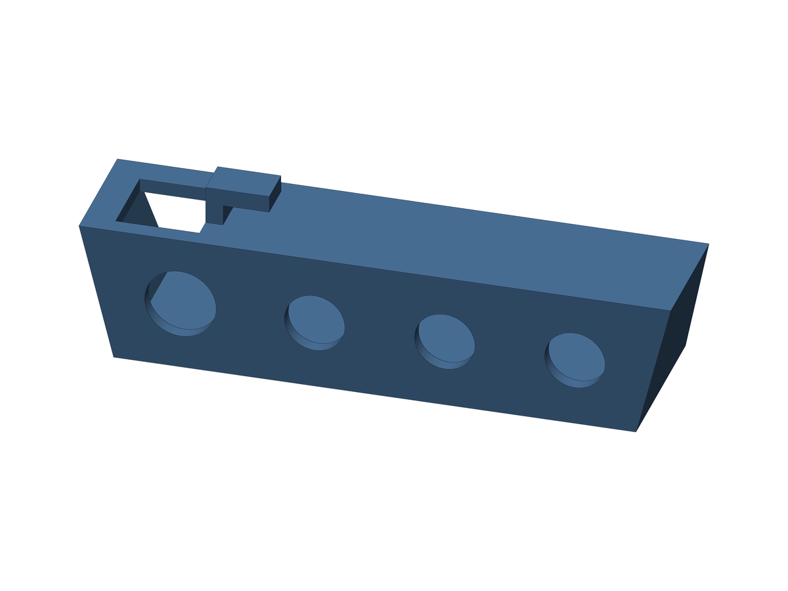
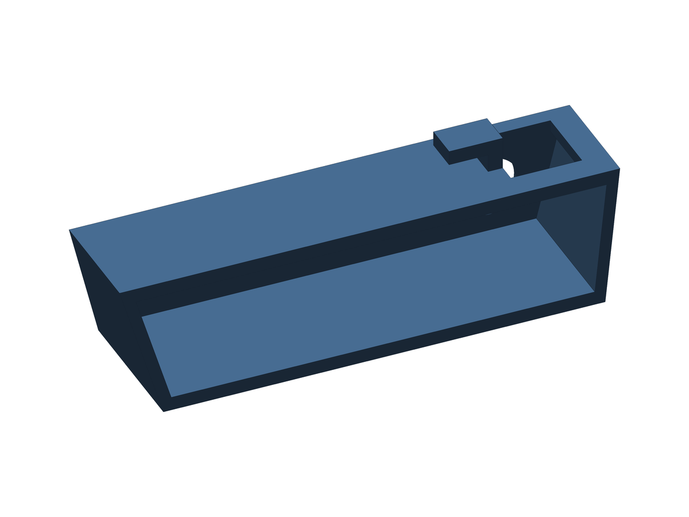

# Bracket with 3 RCA holes and 1 S-Video hole

Same case, with **3 RCA jacks and 1 S-Video jack**, the S-Video at the opening end (the left end facing the RCA face).

 

Case: 85.2 mm long at the top and 75.2 mm at the base, 20.21 mm high, 24.89 mm deep at the bottom and 19.30 mm at the top (slanted back). Wall 2.0 mm, L hook 6 mm wide, top opening 12.10 × 12.10 mm.

**Holes:** S-Video 10.3 mm (10 + 0.3 clearance) and 3 RCA of 8.7 mm, centers at x = 19.41 (S-Video) / 38.73 / 57.46 / 76.19 mm from the opening end: 19.32 mm from the S-Video to the first RCA and 18.73 mm between RCA.

**Longer case:** the first version was 76.2 mm long. It is now 9 mm longer, on the side opposite the L hook, because the RCA nuts are 14.82 mm across the corners and the old 15.66 mm spacing left less than 1 mm between them. The nut-to-nut gap is now about 3.9 mm. The S-Video nut was not measured, and the spacing assumes about 16 mm across the corners.

**Solder lugs:** the ground lug of each RCA jack reaches 17.7 mm from its center, more than the spacing. Bend it 90° toward the open back so it does not touch the neighbor's nut.

**Files:** `exports/av_bracket_svideo_print.stl` (print this one, RCA face down, no supports), `exports/av_bracket_svideo.stl` (Fusion orientation) and `exports/av_bracket_svideo.step`. Optional Fusion scripts: `english/av_bracket_svideo_en` and `portuguese/av_bracket_svideo_pt`.

**Check first:** the 10 mm size comes from retailer listings of round, threaded 4-pin mini-DIN panel sockets, not from a datasheet or a measured jack. Listings vary: 10 to 11 mm for most, and 9/16 in (14.3 mm) for one chassis-mount jack. **Provisional:** the hole uses the smallest size found (10 mm, plus 0.3 mm clearance) until this version is validated with a real jack. If the jack does not fit, enlarge the hole with a rotary tool. A flanged S-Video jack with two screws needs extra holes that this version does not have. Measure your jack before printing.

Back to the [main README](../README.md).

---

# Suporte com 3 furos RCA e 1 furo S-Video

Mesma case, com **3 conectores RCA e 1 S-Video**, com o S-Video na ponta da abertura (a ponta esquerda, de frente para a face RCA).

 

Case: 85,2 mm de comprimento no topo e 75,2 mm na base, 20,21 mm de altura, 24,89 mm de profundidade embaixo e 19,30 mm em cima (traseira inclinada). Parede de 2,0 mm, gancho em L de 6 mm de largura e abertura de cima de 12,10 × 12,10 mm.

**Furos:** S-Video de 10,3 mm (10 + 0,3 de folga) e 3 RCA de 8,7 mm, centros em x = 19,41 (S-Video) / 38,73 / 57,46 / 76,19 mm a partir da ponta da abertura: 19,32 mm do S-Video ao primeiro RCA e 18,73 mm entre os RCA.

**Case mais comprida:** a primeira versão tinha 76,2 mm de comprimento. Agora tem 9 mm a mais, do lado oposto ao gancho em L, porque as porcas RCA medem 14,82 mm de canto a canto e o espaçamento antigo de 15,66 mm deixava menos de 1 mm entre elas. O vão porca a porca agora é de cerca de 3,9 mm. A porca do S-Video não foi medida, e o espaçamento supõe uns 16 mm de canto a canto.

**Lingüetas de solda:** a lingüeta de terra de cada conector RCA alcança 17,7 mm a partir do centro, mais que o espaçamento. Dobre-a 90° para trás, para o lado aberto, para ela não tocar a porca do vizinho.

**Arquivos:** `exports/av_bracket_svideo_print.stl` (imprima este, com a face RCA para baixo e sem suportes), `exports/av_bracket_svideo.stl` (orientação do Fusion) e `exports/av_bracket_svideo.step`. Scripts opcionais do Fusion: `english/av_bracket_svideo_en` e `portuguese/av_bracket_svideo_pt`.

**Confira antes:** os 10 mm vêm de listagens de lojas para soquetes mini-DIN de 4 pinos redondos e roscados, não de um datasheet nem de um conector medido. As listagens variam: de 10 a 11 mm na maioria, e 9/16 pol (14,3 mm) para um conector de chassi. **Provisório:** o furo usa o menor tamanho encontrado (10 mm, mais 0,3 mm de folga) até esta versão ser validada com um conector real. Se o conector não couber, aumente o furo com uma microrretífica. Um conector de S-Video com flange e dois parafusos precisa de furos extras que esta versão não tem. Meça o seu conector antes de imprimir.

Voltar ao [README principal](../README.md).
