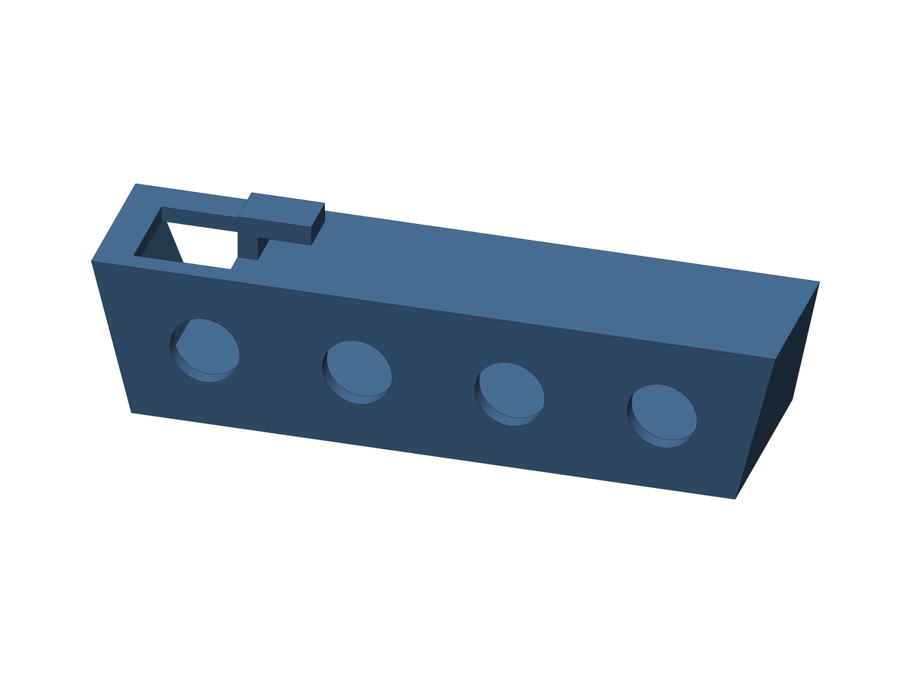
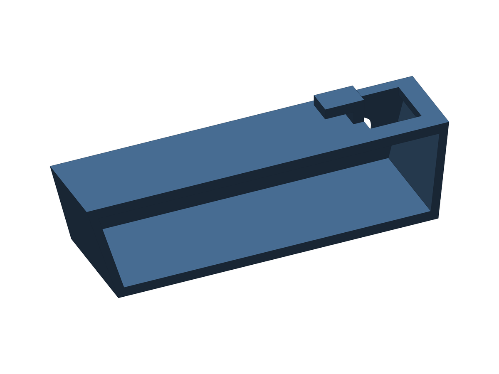

# Bracket with 4 RCA holes

Bracket for the Atari 2600 AV mod with **4 RCA jacks** at the rear of the console.

 

Case: 85.2 mm long at the top and 75.2 mm at the base, 20.21 mm high, 24.89 mm deep at the bottom and 19.30 mm at the top (slanted back). Wall 2.0 mm, L hook 6 mm wide, top opening 12.10 × 12.10 mm.

**Holes:** 4 × 8.7 mm (8.4 + 0.3 clearance), 18.98 mm apart, centers at x = 18.93 / 37.91 / 56.89 / 75.87 mm from the opening end.

**Longer case:** the first version was 76.2 mm long. It is now 9 mm longer, on the side opposite the L hook, because the jack nuts are 14.82 mm across the corners and the old 15.98 mm spacing left only 1.2 mm between them. The gap is now about 4.2 mm.

**Solder lugs:** the ground lug of each jack reaches 17.7 mm from its center, more than the spacing. Bend it 90° toward the open back so it does not touch the neighbor's nut.

**Files:** `exports/av_bracket_4h_print.stl` (print this one, RCA face down, no supports), `exports/av_bracket_4h.stl` (Fusion orientation) and `exports/av_bracket_4h.step`. Optional Fusion scripts: `english/av_bracket_4h_en` and `portuguese/av_bracket_4h_pt`.

Back to the [main README](../README.md).

---

# Suporte com 4 furos RCA

Suporte para o AV mod do Atari 2600 com **4 conectores RCA** na traseira do console.

 

Case: 85,2 mm de comprimento no topo e 75,2 mm na base, 20,21 mm de altura, 24,89 mm de profundidade embaixo e 19,30 mm em cima (traseira inclinada). Parede de 2,0 mm, gancho em L de 6 mm de largura e abertura de cima de 12,10 × 12,10 mm.

**Furos:** 4 × 8,7 mm (8,4 + 0,3 de folga), a 18,98 mm entre centros, centros em x = 18,93 / 37,91 / 56,89 / 75,87 mm a partir da ponta da abertura.

**Case mais comprida:** a primeira versão tinha 76,2 mm de comprimento. Agora tem 9 mm a mais, do lado oposto ao gancho em L, porque as porcas dos conectores medem 14,82 mm de canto a canto e o espaçamento antigo de 15,98 mm deixava só 1,2 mm entre elas. O vão agora é de cerca de 4,2 mm.

**Lingüetas de solda:** a lingüeta de terra de cada conector alcança 17,7 mm a partir do centro, mais que o espaçamento. Dobre-a 90° para trás, para o lado aberto, para ela não tocar a porca do vizinho.

**Arquivos:** `exports/av_bracket_4h_print.stl` (imprima este, com a face RCA para baixo e sem suportes), `exports/av_bracket_4h.stl` (orientação do Fusion) e `exports/av_bracket_4h.step`. Scripts opcionais do Fusion: `english/av_bracket_4h_en` e `portuguese/av_bracket_4h_pt`.

Voltar ao [README principal](../README.md).
