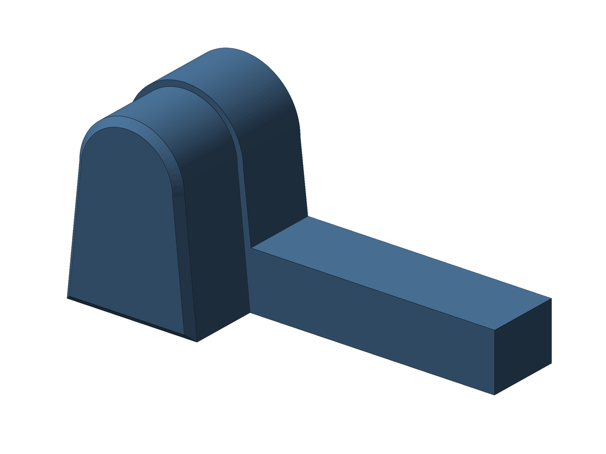
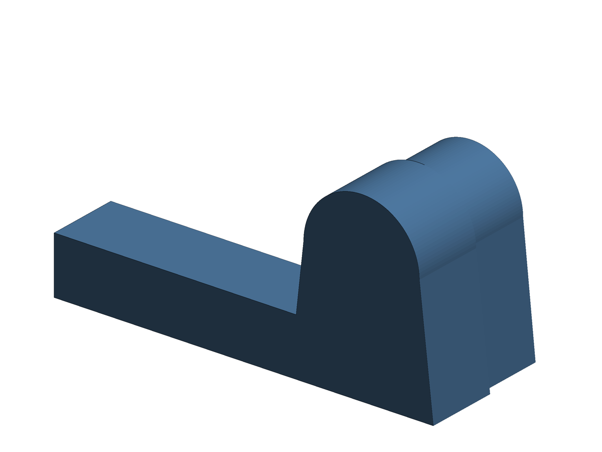

# Arch closure

Separate part that fills the arched notch in the console's rear edge. It goes in from inside the console, and its arm rests against the base of the L hook, which locks the bracket in place. **Shared by all the bracket versions.**

 

**Size:** body 5.70 mm at the base, 4.60 mm at the top and 7.75 mm high, 3.28 mm long (the wall thickness). Protrusion inside 6.33 × 8.00 mm, 3.22 mm thick. Arm 10.70 mm from the notch edge, 2.5 mm high. Whole part 16.71 × 8.00 × 6.50 mm. The notch is 5.69 × 8.02 mm, so the body fits tightly: sand lightly if needed.

**Files:** `exports/av_arch_plug.stl` (print flat, with the protrusion and the arm on the bed, no supports) and `exports/av_arch_plug.step`. Optional Fusion scripts: `english/av_arch_plug_en` and `portuguese/av_arch_plug_pt`.

Back to the [main README](../README.md).

---

# Fecho do arco

Peça separada que preenche o recorte em arco na borda traseira do console. Entra por dentro do console, e o braço encosta na base do gancho em L, o que trava o suporte. **Comum a todas as versões do suporte.**

 

**Medidas:** corpo com 5,70 mm na base, 4,60 mm no topo e 7,75 mm de altura, 3,28 mm de comprimento (a espessura da parede). Protrusão por dentro de 6,33 × 8,00 mm, com 3,22 mm de espessura. Braço com 10,70 mm da borda do recorte e 2,5 mm de altura. Peça toda com 16,71 × 8,00 × 6,50 mm. O recorte mede 5,69 × 8,02 mm, então o corpo encaixa justo: lixe de leve se for preciso.

**Arquivos:** `exports/av_arch_plug.stl` (imprima deitada, com a protrusão e o braço na mesa, sem suportes) e `exports/av_arch_plug.step`. Scripts opcionais do Fusion: `english/av_arch_plug_en` e `portuguese/av_arch_plug_pt`.

Voltar ao [README principal](../README.md).
